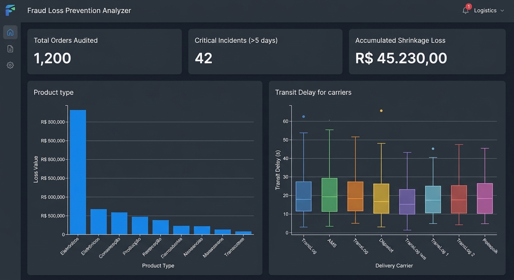
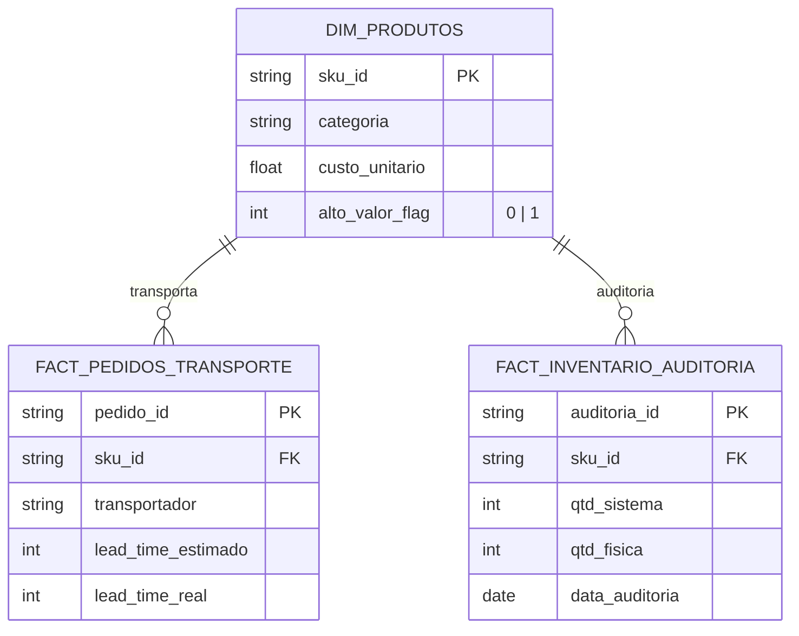

<div align="center">

# 🕵️ Fraud Loss Prevention Analyzer

**Dashboard analítico ponta a ponta que cruza indicadores de transporte com auditoria de inventário para detectar fraudes de frete, desvios de carga e quebras operacionais (shrinkage).**



> [!NOTE]
> A imagem é apenas para definir um objetivo do projeto, tanto o layout quando os dados são inteiramente sintéticos.
</div>

---

## 📑 Sumário

- [Visão Geral](#-visão-geral)
- [Contexto de Negócio (STAR)](#-contexto-de-negócio-star)
- [Indicadores (KPIs)](#-indicadores-kpis)
- [Modelo de Dados](#-modelo-de-dados)
- [Tecnologias](#-tecnologias)
- [Estrutura do Repositório](#-estrutura-do-repositório)
- [Como Executar](#-como-executar)
- [Exemplos de Queries](#-exemplos-de-queries)
- [Premissas e Limitações](#-premissas-e-limitações)
- [Roadmap](#-roadmap)
- [Autor](#-autor)
- [Licença](#-licença)

---

## 📌 Visão Geral

O projeto monitora anomalias de movimentação e divergências de estoque em uma rede de distribuição, a partir de um histórico logístico simulado. A solução apoia gestores de supply chain, gerentes de prevenção de perdas e analistas de auditoria a:

- **Isolar** transportadores e rotas com atrasos atípicos, consistentes com desvios de carga;
- **Quantificar** o impacto financeiro das quebras físicas (shrinkage) no estoque;
- **Identificar** categorias e SKUs de alto valor mais vulneráveis a perdas;
- **Acionar** rapidamente a operação por meio de um painel visual tático com *red flags*.

---

## 📈 Contexto de Negócio (STAR)

| | |
|---|---|
| **Situação** | Em operações logísticas de grande escala, a falta de visibilidade centralizada permite que fraudes de frete e furtos internos passem despercebidos por longos períodos, diluídos em relatórios genéricos de perdas. |
| **Tarefa** | Construir um MVP de pipeline de dados e dashboard interativo com Análise Exploratória de Dados (EDA), cruzando cadastro de produtos (alto valor), histórico de transporte e auditorias cíclicas de inventário. |
| **Ação** | 1. Modelagem relacional com três tabelas integradas (SKUs, transporte e auditoria física).<br>2. Gerador de dados sintéticos em Python com anomalias propositais (comportamento de risco da transportadora *TransLog* e sumiço de Eletrônicos de alto valor).<br>3. Queries SQL para cálculo de prejuízo e dispersão de lead times.<br>4. Dashboard em Streamlit para visualização das *red flags*. |
| **Resultado** | O pipeline detectou as anomalias injetadas: a *TransLog* concentrou cerca de **15% das ocorrências críticas** de atraso e Eletrônicos acima de **R$ 1.000,00** responderam por aproximadamente **80% do prejuízo acumulado** de inventário. Na prática, esse tipo de visibilidade permitiria direcionar auditorias físicas às áreas de maior risco. |

> [!NOTE]
> Os dados são **inteiramente sintéticos**. Os padrões descritos foram parametrizados no gerador para validar se o pipeline e as regras de negócio em SQL/Python conseguem detectá-los. Os resultados acima servem como demonstração de portfólio.

---

## 📐 Indicadores (KPIs)

| KPI | Definição | Fórmula | Granularidade |
|---|---|---|---|
| **Média de Atraso** | Dias adicionais no trânsito real vs. prazo planejado | `AVG(lead_time_real - lead_time_estimado)` | Transportador, Rota, SKU |
| **Ocorrências Críticas** | Entregas com atraso acima do limite aceitável | `COUNT(pedido_id) WHERE (lead_time_real - lead_time_estimado) > 5` | Transportador, Mês |
| **Itens Perdidos (Shrinkage)** | Unidades ausentes identificadas em auditorias | `SUM(qtd_sistema - qtd_fisica)` | SKU, Categoria |
| **Prejuízo Financeiro Acumulado** | Valor monetário das quebras físicas | `SUM(qtd_sistema - qtd_fisica) × custo_unitario` | SKU, Categoria |
| **Taxa de Divergência (%)** | Percentual de erro encontrado nas checagens | `(qtd_sistema - qtd_fisica) / qtd_sistema × 100` | Auditoria, Operador |

---

## 🗄️ Modelo de Dados



---

## 🛠️ Tecnologias

| Camada | Ferramentas |
|---|---|
| Linguagem | Python 3.10+ |
| Manipulação de dados | Pandas, NumPy |
| Banco de dados | SQLite (ANSI SQL) |
| Interface visual | Streamlit + Plotly |

---

## 📂 Estrutura do Repositório

```text
fraud-loss-prevention-analyzer/
│
├── data/
│   ├── generator.py               # Simulação do dataset logístico (seed fixa)
│   └── fraud_analytics.db         # Banco SQLite gerado localmente (ignorado no git)
│
├── sql/
│   ├── schema.sql                 # DDL: tabelas e chaves estrangeiras
│   └── queries_analiticas.sql     # Consultas para monitoramento de fraudes
│
├── dashboard/
│   └── app.py                     # Painel em Streamlit
│
├── docs/
│   └── dashboard_preview.png      # Captura do dashboard
│
├── .gitignore
├── LICENSE
├── requirements.txt
└── README.md
```

---

## 🚀 Como Executar

**Pré-requisitos:** Python 3.10+ e Git.

```bash
# 1. Clone o repositório
git clone https://github.com/hugoarcanjodev/fraud-loss-prevention-analyzer.git
cd fraud-loss-prevention-analyzer

# 2. Crie e ative um ambiente virtual
python -m venv .venv
source .venv/bin/activate      # Linux/macOS
.venv\Scripts\activate         # Windows

# 3. Instale as dependências
pip install -r requirements.txt

# 4. Gere os dados sintéticos e o banco local
python data/generator.py

# 5. Inicie o dashboard
streamlit run dashboard/app.py
```

Acesse **http://localhost:8501** no navegador.

---

## 🔎 Exemplos de Queries

**Desvios críticos de lead time por transportador**

```sql
SELECT
    transportador,
    COUNT(pedido_id) AS total_pedidos,
    ROUND(AVG(lead_time_real - lead_time_estimado), 2) AS media_atraso_dias,
    MAX(lead_time_real - lead_time_estimado) AS atraso_maximo,
    COUNT(CASE WHEN lead_time_real - lead_time_estimado > 5 THEN 1 END) AS ocorrencias_criticas
FROM fact_pedidos_transporte
GROUP BY transportador
ORDER BY media_atraso_dias DESC;
```

**Top 10 SKUs com maior impacto financeiro por shrinkage**

```sql
SELECT
    p.categoria,
    p.sku_id,
    p.custo_unitario,
    SUM(i.qtd_sistema - i.qtd_fisica) AS total_itens_perdidos,
    ROUND(SUM(i.qtd_sistema - i.qtd_fisica) * p.custo_unitario, 2) AS prejuizo_financeiro_acumulado
FROM fact_inventario_auditoria i
JOIN dim_produtos p ON i.sku_id = p.sku_id
WHERE i.qtd_sistema > i.qtd_fisica
GROUP BY p.categoria, p.sku_id, p.custo_unitario
ORDER BY prejuizo_financeiro_acumulado DESC
LIMIT 10;
```

---

## ⚠️ Premissas e Limitações

- Todos os dados são **sintéticos**, gerados por regras estatísticas em Python com seed fixa, o que garante reprodutibilidade.
- Os comportamentos anômalos de transporte e furto **não representam nenhuma empresa real**; são parâmetros configurados para validar o poder das consultas analíticas.
- O prejuízo considera apenas o **custo de reposição unitário**, desconsiderando armazenagem, seguros ou multas contratuais.
- O cálculo de shrinkage considera apenas auditorias em que `qtd_sistema > qtd_fisica` (sobras de estoque não são tratadas neste MVP).
- O limite de atraso crítico (5 dias) é uma premissa de negócio ajustável.

---

## 🗺️ Roadmap

- [ ] Testes de consistência relacional com `pytest`
- [ ] Detecção de anomalias por Z-Score
- [ ] Alertas automatizados por e-mail/Slack
- [ ] Espelhamento do modelo em nuvem (BigQuery / Databricks)

---

## 🧑‍💻 Autor

**Hugo Arcanjo**
Estudante de Engenharia de Produção focado em Logística, Supply Chain Analytics e Prevenção de Perdas com dados.

[](https://www.linkedin.com/in/hugo-arcanjo)
[](https://github.com/hugoarcanjodev)

---

## 📄 Licença

Distribuído sob a licença MIT. Veja o arquivo [LICENSE](LICENSE) para mais detalhes.